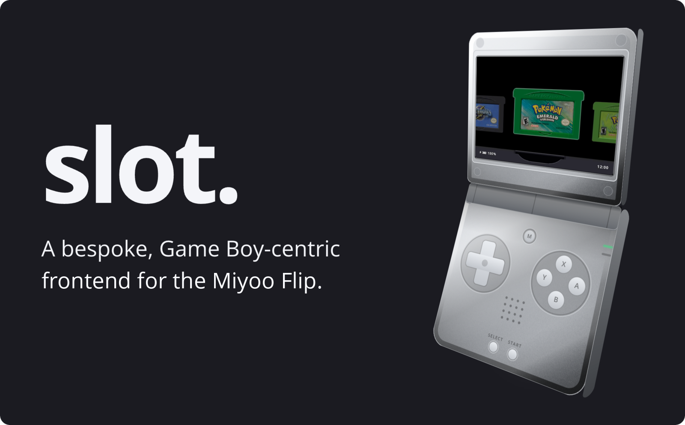

<div align="center">



</div>

# slot for the Miyoo Flip

An unofficial port of **[slot](https://github.com/slot-cfw/slot)** by Brandon Kowalski to the
**Miyoo Flip**, running under [baseos-my355](https://github.com/apommel/baseos-my355). slot is
a Game Boy-centric frontend made for the Anbernic RG SP; its own README, guide
([slot-cfw.fyi](https://slot-cfw.fyi)) and releases are in the original repository.

This page covers only what is different here: how to install it on the Flip and what the port
adds. It is not made or supported by the original author, so please report Flip problems here,
not upstream.

Cart labels: use the matching fork of Cart Studio,
[cart-studio-miyoo-flip](https://github.com/Shcoobz/cart-studio-miyoo-flip).

## Install (no building needed)

The ready-made card is in the [`flip-card/`](flip-card) folder of this repository.

1. Install [baseos-my355](https://github.com/apommel/baseos-my355) on SD card 1 by following
   its install guide.
2. Format a second SD card as FAT32. It goes in the Flip's left slot.
3. Download this repository (Code > Download ZIP, or `git clone`).
4. Copy **everything inside** `flip-card/` (not the folder itself) to the root of card 2.
   `flip-card/` contains a hidden folder, `.tmp_update`, so make sure hidden files are copied
   too.
5. Add your games to `Games/GBA`, `Games/GB`, `Games/GBC`, `Games/NES` and `Games/SNES` (unzipped), put card 2 in the
   left slot and turn the Flip on.

Where labels, bezels, BIOS files, cheats and the stick calibration files go is explained in
[`card/README-FLIP.txt`](card/README-FLIP.txt), which is also copied to the root of the card as
`README-FLIP.txt`.

The short version for the sticks: copy `joypad.config` and `joypad_right.config` from your
Flip's stock firmware (`/userdata`) into `Config/userdata/` on card 2. Without them the analog
sticks are uncalibrated.

## What this fork adds

**Hardware**
- Miyoo Flip support: display, buttons and sticks, lid, rumble, LED, headphones and HDMI.
- TV output over HDMI: NES and SNES fill the screen at 4:3, with a sharp 2× mode.
- Real sleep when the lid is closed.
- Battery savings: Dim Screen and Auto Sleep settings, a CPU cap while a light core plays
  (lifted for fast-forward), and volume set on the codec, with the amplifier off at mute.
- Tilt for games such as WarioWare: Twisted!, steered with a stick (spin or held-angle mode).

**Systems and cores**
- NES (FCEUmm, Nestopia) and Super Nintendo (Snes9x, Snes9x 2005 Plus) on their own shelves,
  with their own button layouts.
- Gambatte for Game Boy and Game Boy Color, with slot's palettes (mGBA and gpSP for GBA, as
  upstream).
- Core per game, per folder or per system.
- Turbo A and B on the Game Boy and NES pads.

**Shelf and menus**
- Folders on the shelf, drawn as taped stacks (one level, e.g. `Games/GBA/Pokemon Hacks/`).
  A opens a folder; START opens its menu: Rename, Cover, Sort, Core, Open at, Paper.
- Game switcher: the recently played games, newest first; X opens a game's save states.
- An Extras shelf: Activity report, Get lucky and Never played (they share one deck, so a
  game comes up again only after all the others have).
- Play-time tracking, shown on the open cartridge (`PLAYED 64 H 10 M · yesterday`).
- Delete a game from its cartridge view with Y.
- Cheats (libretro `.cht` files in `Cheats/<SYS>/`) in the in-game menu.

## Credits

- **slot** by Brandon Kowalski, GPL-3.0: <https://github.com/BrandonKowalski/slot>.
  Nearly everything here is his work; this fork adds the Flip port and the features above.
- **baseos-my355** by apommel: <https://github.com/apommel/baseos-my355>.
- Emulator cores: **mGBA** (MPL-2.0), **gpSP** (GPL-2.0), **Gambatte** (GPL-2.0),
  **FCEUmm** (GPL-2.0), **Nestopia** (GPL-2.0), **Snes9x** and **Snes9x 2005 Plus**
  (non-commercial licence, see below).
- `fsck.exfat` from **exfatprogs** (GPL-2.0).
- Fonts: **Permanent Marker** (Apache-2.0), **VT323** (OFL-1.1).
- Built-in SP bezel: "Perfect GBA SP (no grid)" by mugwomp93 (CC BY-SA 4.0).

## Licence notes

- The fork is licensed under the **GPL-3.0**, like slot. See [`LICENSE`](LICENSE).
- The corresponding source is this repository. The card also carries the source archives,
  patches and build stamps of the bundled cores and of `fsck.exfat` in `System/licenses/`.
- The licence texts of the bundled third-party parts are in [`licenses/`](licenses) (copied to
  `System/licenses/` on the card).
- **No BIOS files, ROMs or third-party bezels are ever included.** Bring your own; bezels made
  by others stay with whoever made them.
- **Snes9x is not GPL.** Its licence forbids commercial use, so the two Snes9x cores ship as
  separate, non-commercial cores next to the GPL build, never folded into it. Their licence
  text is in `licenses/snes9x-non-commercial.txt` and `licenses/snes9x2005-non-commercial.txt`.

Game Boy is a trademark of Nintendo. This project is not affiliated with Nintendo, Miyoo,
Anbernic or the original slot project.

## For developers

### Building the card

```sh
task flip-card
```

This runs `dist:flip` with `OUT=flip-card`: it builds slot for the device, builds mGBA, gpSP,
Gambatte, FCEUmm, Nestopia, Snes9x, Snes9x 2005 Plus and a static `fsck.exfat` from pinned
sources, and writes the whole card tree to
`flip-card/` (the folder is wiped first). `task dist:flip` does the same into `dist-flip/`,
which is not committed.

You need [Docker](https://www.docker.com/) and [go-task](https://taskfile.dev/), plus `curl`,
`file` and `shasum` on the host. The device build runs in an arm64 container automatically
(the `device:sh` task: `docker run --platform linux/arm64 ... rust:1-bullseye`) unless the host
is already Linux on aarch64. On an x86 machine that means Docker needs arm64 emulation
(QEMU/binfmt) set up.

`flip-card/` is committed on purpose, `.so` cores included (`.gitignore` has
`!/flip-card/**`). Rebuild and commit it whenever the source changes.

### Testing on a PC

- The tests run on x86 Linux. An easy way is Docker with `rust:1-bookworm`, using a separate
  target directory so it does not mix with the device build, for example:

  ```sh
  docker run --rm -v "$PWD":/src -w /src rust:1-bookworm \
    cargo test --workspace --target-dir target-x86b
  ```

  The host build pulls in audio, gamepad and EGL libraries, so you will likely need to
  `apt-get install` packages such as `pkg-config`, `libasound2-dev`, `libudev-dev` and Mesa's
  EGL (`libegl1`, `libegl-mesa0`) in the container first.
- `crates/slot/examples/shots.rs` draws slot off-screen and saves chosen frames as PNG, to
  check a screen without the handheld:
  `cargo run -p slot --example shots -- ROOT SCRIPT OUT_DIR [WxH]` (use `640x480` for the Flip).
  The script uses `wait N`, `tap BTN`, `down BTN`, `up BTN` and `shot NAME`.
- `task --list` shows every task. For everything this fork leaves as it was, see the original
  [slot README](https://github.com/slot-cfw/slot#readme) and the guide at
  [slot-cfw.fyi](https://slot-cfw.fyi).

### Cart Studio

Cart labels for this fork are made with the matching Cart Studio fork,
[Shcoobz/cart-studio-miyoo-flip](https://github.com/Shcoobz/cart-studio-miyoo-flip), which reads
cards the way this fork does (game folders, NES and SNES). Its `README.md` explains how to run
it yourself; locally it lives next to this repository in `slot-cart-studio/`.
